<picture>
  <source media="(prefers-color-scheme: dark)" srcset="docs/assets/banner-dark.svg">
  <source media="(prefers-color-scheme: light)" srcset="docs/assets/banner-light.svg">
  
</picture>

<p align="center">
<picture>
  <source media="(prefers-color-scheme: dark)" srcset="docs/assets/badge-version-dark.svg">
  <source media="(prefers-color-scheme: light)" srcset="docs/assets/badge-version-light.svg">
  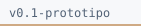
</picture>
<picture>
  <source media="(prefers-color-scheme: dark)" srcset="docs/assets/badge-python-dark.svg">
  <source media="(prefers-color-scheme: light)" srcset="docs/assets/badge-python-light.svg">
  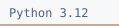
</picture>
<picture>
  <source media="(prefers-color-scheme: dark)" srcset="docs/assets/badge-tests-dark.svg">
  <source media="(prefers-color-scheme: light)" srcset="docs/assets/badge-tests-light.svg">
  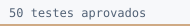
</picture>
<picture>
  <source media="(prefers-color-scheme: dark)" srcset="docs/assets/badge-license-dark.svg">
  <source media="(prefers-color-scheme: light)" srcset="docs/assets/badge-license-light.svg">
  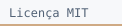
</picture>
<picture>
  <source media="(prefers-color-scheme: dark)" srcset="docs/assets/badge-streamlit-dark.svg">
  <source media="(prefers-color-scheme: light)" srcset="docs/assets/badge-streamlit-light.svg">
  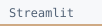
</picture>
</p>

<p align="center">
<a href="docs/guia_execucao.md"><picture>
  <source media="(prefers-color-scheme: dark)" srcset="docs/assets/nav-execucao-dark.svg">
  <source media="(prefers-color-scheme: light)" srcset="docs/assets/nav-execucao-light.svg">
  
</picture></a>
<a href="docs/guia_tecnico.md"><picture>
  <source media="(prefers-color-scheme: dark)" srcset="docs/assets/nav-tecnico-dark.svg">
  <source media="(prefers-color-scheme: light)" srcset="docs/assets/nav-tecnico-light.svg">
  
</picture></a>
<a href="docs/Registros_Desenvolvimento_IntegraSol.docx"><picture>
  <source media="(prefers-color-scheme: dark)" srcset="docs/assets/nav-registro-dark.svg">
  <source media="(prefers-color-scheme: light)" srcset="docs/assets/nav-registro-light.svg">
  
</picture></a>
</p>

O IntegraSol mostra como pequenas contribuições de uma grade podem ser somadas para aproximar uma integral tripla. O protótipo trabalha com uma **esfera centrada na origem, em coordenadas cartesianas e com densidade constante**.

O usuário ajusta os parâmetros, acompanha o sólido em três dimensões, consulta a contribuição de uma célula e compara os resultados numéricos com referências analíticas. O núcleo implementa os pontos médios, o pertencimento à esfera, os pesos e as somas; a superfície gráfica serve como representação do domínio.

<a id="recursos"></a>
<h2>
<picture>
  <source media="(prefers-color-scheme: dark)" srcset="docs/assets/section-01-dark.svg">
  <source media="(prefers-color-scheme: light)" srcset="docs/assets/section-01-light.svg">
  
</picture>
</h2>

- **Cálculo numérico:** volume, massa, primeiros momentos e centro de massa.
- **Visualização 3D:** esfera, pontos de amostragem, centro e célula destacada.
- **Inspeção por índices:** coordenadas, passos, Jacobiano, pertencimento, peso e parcela de massa.
- **Validação:** referências independentes, erros e comparação das resoluções 10, 20 e 40.
- **Estado da aplicação:** atualização pelo botão Calcular e aviso quando os parâmetros foram alterados.


<picture>
  <source media="(prefers-color-scheme: dark)" srcset="docs/assets/divider-dark.svg">
  <source media="(prefers-color-scheme: light)" srcset="docs/assets/divider-light.svg">
  
</picture>

<a id="inicio-rapido"></a>
<h2>
<picture>
  <source media="(prefers-color-scheme: dark)" srcset="docs/assets/section-02-dark.svg">
  <source media="(prefers-color-scheme: light)" srcset="docs/assets/section-02-light.svg">
  
</picture>
</h2>

Com **Python 3.12 de 64 bits** instalado, extraia o projeto e abra o terminal na pasta que contém `app.py`. No Windows:

```powershell
py -3.12 -m venv .venv
.\.venv\Scripts\python.exe -m pip install -r requirements.txt
.\.venv\Scripts\python.exe -m streamlit run app.py
```

A aplicação fica disponível em **http://localhost:8501**. Para encerrar, use **Ctrl+C** no terminal.

O [guia de execução](docs/guia_execucao.md) detalha a instalação, o uso em outro computador, os testes e a solução de problemas comuns.


<picture>
  <source media="(prefers-color-scheme: dark)" srcset="docs/assets/divider-dark.svg">
  <source media="(prefers-color-scheme: light)" srcset="docs/assets/divider-light.svg">
  
</picture>

<a id="exploracao"></a>
<h2>
<picture>
  <source media="(prefers-color-scheme: dark)" srcset="docs/assets/section-03-dark.svg">
  <source media="(prefers-color-scheme: light)" srcset="docs/assets/section-03-light.svg">
  
</picture>
</h2>

1. Mantenha o exemplo inicial — **R=2 m, densidade=1 kg/m³ e n=40** — e clique em **Calcular**.
2. Gire a cena e consulte os índices **(20, 20, 20)** para observar uma célula aceita.
3. Selecione **(0, 0, 0)** para observar uma célula externa, com contribuição nula.
4. Abra **Como o computador calculou?** e acompanhe o percurso da região até a soma.
5. Compare a tabela de refinamento. Ao alterar raio ou densidade, clique novamente em **Calcular**.

**Restaurar exemplo** retorna à configuração inicial. A seleção de uma célula não executa uma nova integração.

<picture>
  <source media="(prefers-color-scheme: dark)" srcset="docs/assets/flow-dark.svg">
  <source media="(prefers-color-scheme: light)" srcset="docs/assets/flow-light.svg">
  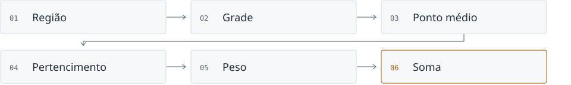
</picture>


<picture>
  <source media="(prefers-color-scheme: dark)" srcset="docs/assets/divider-dark.svg">
  <source media="(prefers-color-scheme: light)" srcset="docs/assets/divider-light.svg">
  
</picture>

<a id="resultados"></a>
<h2>
<picture>
  <source media="(prefers-color-scheme: dark)" srcset="docs/assets/section-04-dark.svg">
  <source media="(prefers-color-scheme: light)" srcset="docs/assets/section-04-light.svg">
  
</picture>
</h2>

Para raio de 2 m e densidade de 1 kg/m³, a referência analítica do volume é **32π/3 ≈ 33,51032164 m³**.

<picture>
  <source media="(prefers-color-scheme: dark)" srcset="docs/assets/error-dark.svg">
  <source media="(prefers-color-scheme: light)" srcset="docs/assets/error-light.svg">
  
</picture>

| Subdivisões por eixo | Volume aproximado | Erro relativo |
|:---:|---:|---:|
| 10 | 35,328000 m³ | 5,424234% |
| 20 | 33,792000 m³ | 0,840572% |
| 40 | 33,552000 m³ | **0,124375%** |

<br clear="all">

A execução registrada aprovou **50 testes**, incluindo o cálculo e o estado da interface. O [guia técnico](docs/guia_tecnico.md) apresenta as fórmulas e o ambiente verificado; os [resultados completos](docs/resultados_verificados.json) e a [saída dos testes](docs/execucao-testes.txt) permanecem disponíveis.

Para repetir a verificação:

```powershell
.\.venv\Scripts\python.exe -m pytest -v
```


<picture>
  <source media="(prefers-color-scheme: dark)" srcset="docs/assets/divider-dark.svg">
  <source media="(prefers-color-scheme: light)" srcset="docs/assets/divider-light.svg">
  
</picture>

<a id="organizacao"></a>
<h2>
<picture>
  <source media="(prefers-color-scheme: dark)" srcset="docs/assets/section-05-dark.svg">
  <source media="(prefers-color-scheme: light)" srcset="docs/assets/section-05-light.svg">
  
</picture>
</h2>

| Local | Responsabilidade |
|---|---|
| [app.py](app.py) | Coordena o cálculo, a apresentação e o estado da sessão |
| [calculo/](calculo/) | Define geometria, Jacobiano, integração e referências |
| [interface/](interface/) | Constrói os componentes Streamlit e a cena Plotly |
| [tests/](tests/) | Verifica o motor, a inspeção, a visualização e o estado |
| [docs/](docs/) | Reúne os guias, o registro de atividades e as evidências |

A camada de cálculo funciona sem Streamlit ou Plotly. As referências analíticas são utilizadas na validação, separadas da aproximação numérica.

**Tecnologias:** Python 3.12 · NumPy 2.3.5 · Streamlit 1.51.0 · Plotly 6.5.0 · pytest 8.4.2. As dependências estão em [requirements.txt](requirements.txt); a combinação completa do ambiente está em [requirements-lock.txt](requirements-lock.txt).


<picture>
  <source media="(prefers-color-scheme: dark)" srcset="docs/assets/divider-dark.svg">
  <source media="(prefers-color-scheme: light)" srcset="docs/assets/divider-light.svg">
  
</picture>

<a id="documentacao"></a>
<h2>
<picture>
  <source media="(prefers-color-scheme: dark)" srcset="docs/assets/section-06-dark.svg">
  <source media="(prefers-color-scheme: light)" srcset="docs/assets/section-06-light.svg">
  
</picture>
</h2>

| Documento | Quando consultar |
|---|---|
| [Guia de execução](docs/guia_execucao.md) | Para instalar, executar, testar e demonstrar a aplicação |
| [Guia técnico](docs/guia_tecnico.md) | Para entender o método, os módulos, os resultados e os limites |
| [Registro de atividades](docs/Registros_Desenvolvimento_IntegraSol.docx) | Para acompanhar o histórico e as decisões no documento de sete páginas fornecido pelos autores |

As evidências de execução ficam nos dois arquivos de resultados citados acima.


<picture>
  <source media="(prefers-color-scheme: dark)" srcset="docs/assets/divider-dark.svg">
  <source media="(prefers-color-scheme: light)" srcset="docs/assets/divider-light.svg">
  
</picture>

<a id="escopo"></a>
<h2>
<picture>
  <source media="(prefers-color-scheme: dark)" srcset="docs/assets/section-07-dark.svg">
  <source media="(prefers-color-scheme: light)" srcset="docs/assets/section-07-light.svg">
  
</picture>
</h2>

A interface permite raio de **0,5 a 3 m**, densidade de **0,5 a 3 kg/m³** e resolução **10, 20 ou 40**. A cena desenha até **3.000 pontos médios**, incluindo a seleção; a soma considera toda a grade. Células na fronteira são aceitas ou rejeitadas pelo ponto médio, sem recorte exato pela superfície.

> [!NOTE]
> Outros sólidos, densidade variável, sistemas curvilíneos e importação de modelos não integram esta versão.

 O registro considera o escopo do protótipo concluído em **27/10/2026**, no cenário documental; datas e encontros estão identificados como reconstrução simulada. A versão final está prevista para **16/12/2026**.

> [!IMPORTANT]
> O ambiente verificado foi Python 3.12/Linux. A instalação nas duas máquinas da equipe e a conferência visual no navegador permanecem a confirmar.


<picture>
  <source media="(prefers-color-scheme: dark)" srcset="docs/assets/divider-dark.svg">
  <source media="(prefers-color-scheme: light)" srcset="docs/assets/divider-light.svg">
  
</picture>

<a id="autores"></a>
<h2>
<picture>
  <source media="(prefers-color-scheme: dark)" srcset="docs/assets/section-08-dark.svg">
  <source media="(prefers-color-scheme: light)" srcset="docs/assets/section-08-light.svg">
  
</picture>
</h2>

**Ana Julia Santiago Vieira**  
**Cauã Henrique Feitosa de Souza**

Projeto acadêmico de Cálculo III do curso de Ciência da Computação da Fundação Universidade Federal de Rondônia.

Código disponibilizado sob a [licença MIT](LICENSE).
